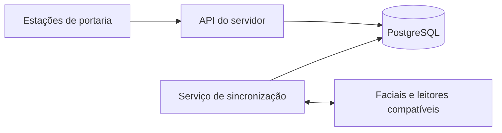

# Arquitetura

O servidor centraliza as regras e os registros do condomínio. As estações utilizam uma API, sem acesso direto ao PostgreSQL para a operação diária. A comunicação com equipamentos é executada pelos serviços do servidor.

## Responsabilidades

| Componente | Responsabilidade |
| --- | --- |
| Interface | Atendimento, formulários, consulta e retorno das operações |
| API | Autenticação, permissões e validação das regras |
| Banco | Persistência dos cadastros e das movimentações |
| Sincronizador | Comunicação com dispositivos e acompanhamento das filas |
| Adaptadores | Tratamento dos protocolos e das respostas de cada fabricante |

## Operação sem conexão

A estação mantém uma cópia dos dados já recebidos e uma fila persistente para as operações offline previstas. Cada fila está vinculada ao servidor e ao usuário correspondente. A reconexão é automática e os reenvios possuem identificação para evitar duplicações causadas pela repetição da mesma solicitação.

Isso não equivale a replicar todo o banco na estação. Acesso offline exige validação prévia do usuário naquele computador e possui limites. Conflitos e operações recusadas precisam de conferência; não devem desaparecer silenciosamente da fila.

## Equipamentos

O terminal realiza o reconhecimento facial e pode manter suas próprias credenciais locais. O GCAM prepara os cadastros e as autorizações e acompanha a distribuição para os dispositivos compatíveis.

Regras que dependem da comunicação entre entrada e saída não podem ser garantidas se essa comunicação estiver indisponível. A homologação deve verificar também o comportamento do equipamento sem o servidor, não apenas a operação conectada.

## Decisões técnicas

- Validação de permissões e regras no servidor, não apenas na interface.
- Banco operacional centralizado, com histórico e auditoria.
- Separação entre interface, domínio, persistência e integrações.
- Servidor executado como serviço do Windows.
- Atualização da estrutura do banco sob responsabilidade do servidor.
- Tratamento distinto para falha de comunicação e confirmação de uma ação física.

Esta é uma visão de alto nível. Configurações internas, credenciais e detalhes do ambiente de uma instalação não são publicados.
